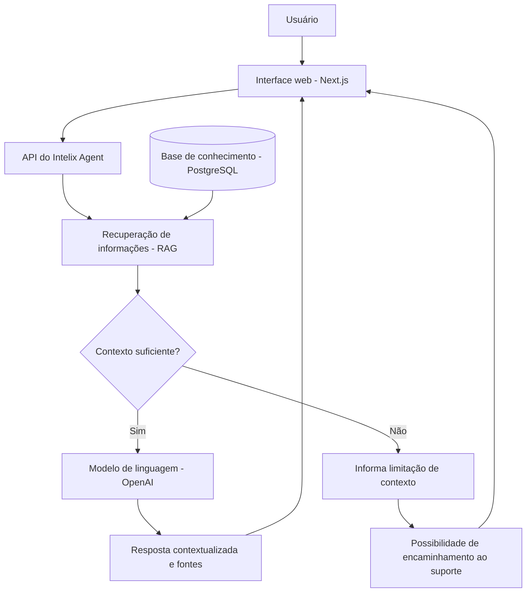

# 🤖 Intelix Agent

**Agente autônomo de Inteligência Artificial para suporte técnico em sistemas de gestão empresarial (ERP).**


Projeto desenvolvido como Trabalho de Conclusão de Curso (TCC) de Ciência da Computação da Universidade do Oeste de Santa Catarina (Unoesc), campus São Miguel do Oeste, em 2026.

## Visão geral

O Intelix Agent é uma plataforma web funcional que combina Modelos de Linguagem de Grande Escala (LLMs) e a técnica de Retrieval-Augmented Generation (RAG) para interpretar perguntas em linguagem natural e fornecer respostas contextualizadas a partir de uma base de conhecimento específica de sistemas ERP.

A solução busca auxiliar equipes de suporte técnico na consulta a procedimentos e na resolução de dúvidas recorrentes, atuando como ferramenta complementar ao atendimento humano.

## Funcionalidades

| Módulo | Descrição |
| --- | --- |
| Dashboard | Indicadores e acompanhamento dos atendimentos e das interações. |
| Chat IA | Conversas em linguagem natural, histórico, respostas fundamentadas e apresentação de fontes. |
| Chamados | Registro, acompanhamento, priorização e encaminhamento de demandas ao suporte humano. |
| Base de conhecimento | Cadastro, upload, processamento e gerenciamento de documentos utilizados pelo agente. |
| Usuários e autenticação | Login, cadastro, recuperação de senha e controle de acesso por perfil (ADMIN, SPECIALIST e ANALYST). |
| Feedback | Avaliação da utilidade das respostas e registro de comentários. |
| Avaliação da plataforma | Questionário sobre facilidade de uso, relevância, tempo de resposta e intenção de reutilização. |
| Auditoria e métricas | Registro de operações, tempo de resposta, fontes recuperadas e ocorrências sem contexto suficiente. |

## Arquitetura e funcionamento



Os documentos são processados e divididos em trechos, com geração de embeddings para auxiliar a recuperação semântica. O mecanismo RAG seleciona informações relevantes antes da geração da resposta, aplicando critérios de relevância e filtros para reduzir a recuperação de conteúdo inadequado.

Quando não há contexto suficiente, o agente sinaliza essa limitação, permitindo o encaminhamento da demanda ao atendimento humano. A utilização do RAG não elimina completamente a possibilidade de respostas incorretas.

## Tecnologias e infraestrutura

| Tecnologia | Finalidade |
| --- | --- |
| Next.js 15 e React 19 | Interface web e API |
| TypeScript | Desenvolvimento tipado |
| OpenAI SDK | Modelos de linguagem e embeddings |
| RAG | Recuperação e contextualização de informações |
| PostgreSQL / Neon | Persistência de usuários, documentos, trechos, chamados e interações |
| Prisma 5 | Acesso ao banco e modelagem dos dados |
| JWT (jose) e bcryptjs | Autenticação e proteção de senhas |
| Tailwind CSS 4 e shadcn | Componentes e estilização |
| Recharts | Visualização de indicadores |
| Zod | Validação de dados |
| Vercel | Hospedagem da aplicação web |

## Base de conhecimento

A base contempla procedimentos e dúvidas operacionais relacionados a documentos fiscais eletrônicos, estoque, inventário, PCP, cadastros, financeiro e suporte geral.

O sistema possui gerenciamento de documentos pela interface, persistência dos conteúdos e trechos no PostgreSQL e suporte a processamento de arquivos. O fluxo legado de indexação também permanece disponível nos scripts do projeto.

A base utilizada na avaliação inclui materiais provenientes do contexto empresarial. Documentos internos e dados de clientes não devem ser publicados sem autorização e tratamento adequado.

## Executando localmente

### Pré-requisitos

- Node.js compatível com Next.js 15 e npm.
- Banco PostgreSQL dedicado ao ambiente de desenvolvimento.
- Chave de API válida da OpenAI.

### 1. Clone o repositório e instale as dependências

```bash
git clone https://github.com/depinegui/intelix-agent.git
cd intelix-agent
npm install
```

### 2. Configure o ambiente

Crie um arquivo `.env` na raiz, utilizando [`.env.example`](.env.example) como referência.

```dotenv
DATABASE_URL=
JWT_SECRET=
OPENAI_API_KEY=
OPENAI_MODEL=gpt-5.5
NEXT_PUBLIC_APP_URL=http://localhost:3000
INTELIX_DEMO_PASSWORD=
```

Utilize um segredo JWT aleatório de pelo menos 32 caracteres, uma conexão PostgreSQL válida e credenciais próprias. O modelo configurado deve estar disponível na conta OpenAI utilizada. A senha de demonstração destina-se exclusivamente ao seed local.

### 3. Prepare o banco de dados

```bash
npm run db:generate
npm run db:push
```

O schema Prisma está em `database/schema.prisma`. Utilize um banco de desenvolvimento, não o banco de produção.

Para popular um ambiente local de demonstração, revise `database/seed.ts` e configure a senha local antes de executar:

```bash
npm run db:seed
```

### 4. Inicie a aplicação

```bash
npm run dev
```

Acesse http://localhost:3000. Cadastre ou utilize um usuário autorizado e adicione documentos apropriados à base de conhecimento antes de testar o chat.

### Scripts adicionais

| Comando | Finalidade |
| --- | --- |
| `npm run index:knowledge` | Indexação da base legada |
| `npm run import:knowledge` | Importação da base legada |
| `npm run diagnose:rag` | Diagnóstico da recuperação de informações |
| `npm run db:migrate` | Desenvolvimento de migrações Prisma |
| `npm run lint` | Verificação estática |
| `npm run typecheck` | Verificação de tipos |
| `npm run build` | Compilação para produção |
| `npm run start` | Inicialização da aplicação compilada |

Revise os scripts de importação e indexação antes de executá-los em um ambiente com dados existentes.

## Exemplos de utilização

Com os documentos correspondentes disponíveis na base, o agente pode receber perguntas como:

- Como resolver a rejeição 204 da NF-e?
- Como emitir um boleto?
- Como cadastrar um produto?

As respostas são apresentadas com as fontes recuperadas quando disponíveis.

## Avaliação e resultados

A plataforma foi avaliada na **Microsys Sistemas**, empresa desenvolvedora de sistemas ERP localizada no Oeste de Santa Catarina, entre outubro e novembro de 2026.

A avaliação envolveu testes funcionais e um questionário de satisfação com quatro questões objetivas em escala de cinco pontos e uma questão aberta para comentários e sugestões.

Foram considerados os seguintes critérios:

- Facilidade de utilização.
- Relevância das respostas.
- Satisfação com o tempo de resposta.
- Intenção de reutilização da ferramenta.

Os resultados foram favoráveis à utilização do Intelix Agent como ferramenta complementar ao suporte técnico. A implementação demonstrou a viabilidade técnica da proposta e apresentou evidências iniciais positivas no contexto avaliado, sem estabelecer uma redução comprovada de custos ou do volume de atendimentos.

## Segurança e privacidade

- Autenticação baseada em JWT e controle de acesso por perfil.
- Armazenamento de senhas em formato de hash.
- Registro de ações e interações para auditoria.
- Credenciais e segredos configurados por variáveis de ambiente.
- Tratamento e anonimização de informações pessoais ou confidenciais antes da inclusão na base, observando a Lei Geral de Proteção de Dados (LGPD).

Não versione arquivos `.env`, credenciais, documentos internos ou dados reais de clientes. A utilização em produção requer avaliação contínua de segurança, privacidade e permissões.

## Trabalhos futuros

- Ampliação e atualização contínua da base de conhecimento.
- Aprimoramento da recuperação de informações e avaliação da qualidade das respostas.
- Avaliações com mais participantes e em períodos mais extensos.
- Investigação de impactos operacionais no suporte técnico.
- Evolução das integrações com sistemas ERP.

## Contexto acadêmico

| | |
| --- | --- |
| Projeto | Intelix Agent — Agente Autônomo de IA para Suporte em Sistemas ERP |
| Curso | Bacharelado em Ciência da Computação |
| Instituição | Universidade do Oeste de Santa Catarina — Unoesc |
| Campus | São Miguel do Oeste — SC |
| Autores | Guilherme Depiné Neto e Maria Cecília Schneider de Oliveira |
| Orientadora | M.ª Franciele Carla Petry |
| Ano | 2026 |

---

<p align="center">Desenvolvido como Trabalho de Conclusão de Curso em Ciência da Computação — Unoesc, 2026.</p>
